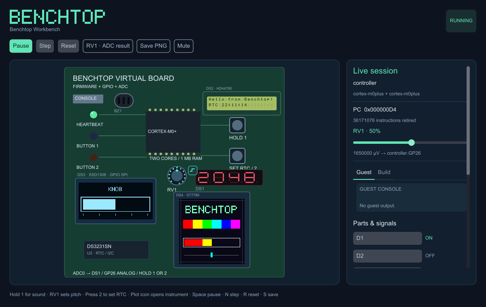

# benchtop

A microcontroller emulator written in sysl. Run Cortex-M firmware on virtual boards,
interact with GPIO LEDs and buttons in a syslUI desktop window, inspect board descriptions,
and execute named RISC-V cores including Hazard3. Real Pico 2 peripheral emulation
is still in progress. It is an interpreter; a JIT is not planned.

*An independent sysl project. It is not affiliated with or endorsed by Arm, Raspberry Pi or STMicroelectronics, or their trademark holders; Cortex is a trademark of Arm Limited.*

## Status

**Twelve Cortex-M models run scalar firmware on virtual boards:** M0, M0+, M1, M3, M4, M7,
M23, M33, M35P, M52, M55 and M85. Extensions and limitations are listed below; this is not
TrustZone or Helium emulation. Integer DSP and the floating-point unit (single precision, or double
on the M7) are available through board options. No complete real board is emulated; the
STM32H747I-Discovery description is a core bring-up with virtual peripherals.
[DESIGN.md](DESIGN.md) is the design note: the architecture, the CPU interpreter, each board's
devices, how fidelity is tested against real boards, and the milestones with their estimates.



## Try the visual workbench

The desktop uses **syslUI**, its shared **SDL3 driver**, and **PlutoVG** for vector
graphics and font rendering. Install SDL3, libuv and pkg-config (`brew install sdl3 libuv pkg-config`
on macOS), then use sysl 0.7.0 or newer:

```sh
sysl build . -o benchtop
./benchtop demo
```

The bundled firmware is written in sysl and compiled for Cortex-M0+. It drives a
heartbeat LED and reads two active-low
buttons through MMIO. Hold **1** or **2**, or click and hold either button, to light
its corresponding LED. Turn **RV1** on the board (drag around the dial), or use
its inspector slider, to change the ADC input. Sysl firmware multiplexes the four-digit
**DS1** display through GPIO: `0000` at minimum, `2048` halfway and `4095` at maximum.
The GPIO-connected **DS2** character LCD shows **“Hello from Benchtop!”** after
firmware initialization. The **DS3** 128×64 SSD1306 OLED shows a graphical knob
gauge, sent by the sysl firmware over GPIO SPI. The **DS4** 240×240 ST7789 color TFT
shows the pixel wordmark, color bars and a second knob gauge on that same SPI bus.
Hold **1** to hear the **BZ1** piezo; RV1 controls its pitch. The toolbar's
**Mute / Unmute** controls host playback. On macOS SDL uses Core Audio. The board
also includes **U2**, a DS3231SN RTC whose time firmware reads over I²C and writes
to LCD line two. It starts from the Mac’s local time. Press **2** to demonstrate
setting it to **12:34:56** through firmware; it then continues from that value.
The demo produces no console output.
See [audio, RTC and real-part catalog entries](docs/audio-and-rtc.md).

The workbench and matrix firmware now execute from flash at `0x10000000`, with
RAM at `0x20000000` and sysl startup that copies `.data` and clears `.bss`.
The workbench describes an external W25Q32JV part; the matrix uses on-chip flash.
See [flash configuration and current hardware limits](docs/flash.md).

The [touchscreen example](examples/touch/README.md) runs `imui` inside flash-linked
sysl firmware, using its optional PlutoVG painter for antialiased TrueType text,
an ST7789 display and a GT911 I²C touch controller. Click its
counter button, toggle a GPIO LED, and drag the brightness slider:

```sh
./benchtop run --window --board boards/touch.hocon examples/touch/demo.elf
```

The real-chip boards run in the same window: a Pico 2 with a button, a seven-segment digit, an
HD44780 and a buzzer on its header ([parts on a Pico board](#parts-on-a-pico-pico-2-or-pico-2-risc-v-board)):

```sh
./benchtop run --window --board testdata/rp-parts/pico2-parts.hocon examples/pico2/parts.elf
```

A separate [digital audio demo](examples/audio/README.md) adds a MAX98357A-style
PCM amplifier/speaker and an INMP441 MEMS microphone backed by the Mac's input.
Hold **1** to play a tone; the firmware displays microphone level on GPIO LEDs:

```sh
./benchtop run --window --board boards/audio.hocon examples/audio/demo.elf
```

Click **RV1**’s small plot icon, right-click RV1, or use **RV1 · ADC result**
in the toolbar to open a movable,
resizable instrument window. **Hold / Resume** freezes only the instrument;
**Clear** clears its history. In that window, **Space** toggles Hold and **C** clears.
Closing it leaves the firmware running. The **Guest / Build** output tabs remain
available even when the firmware is quiet.

Instruments are configured separately from hardware descriptions. The demo loads
[instruments/workbench.hocon](instruments/workbench.hocon); other windowed sessions
can load an instrument set with `--instruments file.hocon`.
See [instrument configuration and numeric sources](docs/instruments.md).

**Space** pauses, **N** executes one instruction per active
core, **R** resets, **S** saves a PNG, and **Escape** closes the window. The toolbar
provides the same controls. Click a part to inspect its wiring. The scrollable inspector shows wiring, signal
states, and actual guest console
output; LEDs reflect actual GPIO output and direction registers. The layout adapts
to the window, with fonts rasterized at the display density.

The **Guest** console is a terminal on the board's console — the same one `benchtop
run` connects to the host's terminal, so on the STM32H747I-DISCO it is the USART1
virtual COM port. Click in it to type: a block cursor shows at the column the guest
writes next, and every key goes to the guest, raw, as a serial terminal sends it.
The guest echoes and edits the line itself. **Enter** sends a newline (`\n`, as
`benchtop run` passes Enter on), **Backspace** DEL (0x7F), **Tab** and **Escape**
themselves, the arrows, **Home**, **End** and **Delete** VT100 sequences, and
**Ctrl** with a letter its control byte, so **Ctrl-C** reaches the guest. Typed text
is sent as UTF-8. While the console has the keyboard, Space, N, R, S, B, Escape and
the board's key bindings go to the guest instead; **Ctrl-]** (which ends `benchtop
run`) or a click anywhere else gives the keyboard back to the window. ⌘ shortcuts
stay the window's.

The console keeps the last 5,000 lines. The wheel over it, or **PgUp** / **PgDn**
while it has the keyboard, scrolls through them; new output follows at the bottom
unless you have scrolled up, and typing returns to the bottom. A carriage return,
backspace and erase-to-end-of-line edit the line as a terminal does; other escape
sequences are not shown. Long lines are not wrapped, and one longer than 4,096 bytes
is broken there. The history survives a reset or a reload. A windowed session does
not read the host's standard input, so the console is the guest's only input, and
keys sent after the guest's input has ended are refused with a notice.

```sh
./benchtop view pico2
./benchtop view pico-breadboard-kit
./benchtop render pico2 pico2.png
./benchtop run --window --board workbench examples/visual/demo.elf
./benchtop demo --headless --frames 60 --screenshot demo.png
```

`view` and `render` inspect existing descriptions, including products. Hardware
without modelled peripherals is labelled **LAYOUT PREVIEW**; display placeholders
are not emulated displays. Live execution uses Cortex-M virtual boards
and parallel execution of launched guest cores on distinct host threads.
Use `--deterministic` for reproducible serial interleaving. Headless UI runs
remain deterministic. Normal desktop execution uses two persistent host CPU
workers. Core 0 never executes guest instructions on the UI thread, and core 1's
worker waits until firmware launches it. CPU workers pace themselves from the
MCU clock and host monotonic time, independently of UI redraws. The UI reads
published CPU snapshots and locked device observations; only pause, step, reset,
reload and shutdown wait for a safe boundary. No worker is recreated per frame.
Normal paced workers each use their own configured clock domain and monotonic
host-time checkpoints. The coordinator no longer distributes short lockstep
pacing batches. Live per-core snapshots are published independently; pause,
reset and debugger steps still obtain a coherent stopped pair. Real-time cores have no global time-lead limit: a slower core reports lateness
rather than holding its peer back. Shared RAM atomics, explicit firmware barriers,
FIFO ordering and device locks remain. Cycle-accurate cross-core instruction
ordering is not promised; explicit deterministic/manual execution retains the
older coordinated scheduler.
The board view uses a fixed 1:1 layout scale; resizing changes its viewport,
not the size of its components. TFT images use one guest pixel per framebuffer
pixel, including on Retina displays, so firmware antialiasing is not enlarged
or smoothed by the host.
`--frames N` bounds either windowed or headless runs. PNG exports use the same
syslUI view tree and PlutoVG renderer at a standard
1200×760 size. Headless rendering also needs an installed system font (Arial on
macOS, or DejaVu Sans/Liberation Sans on Linux); it needs no display server. See [examples/visual](examples/visual/README.md) to build
and modify the firmware and for the virtual GPIO register map.

## Parts, references and analogue input

`potentiometer` is a built-in part; `virt-adc` is a built-in chip peripheral.
A part's terminals are wired under `wire`, to the board's own pins written bare:

```hocon
volume {
  part = potentiometer
  ref = RV1
  position = 50
  low-uv = 0
  high-uv = 3300000
  taper = linear
  wire { wiper = GP26 }
}
```

`volume` is the instance identifier and `RV1` its schematic/silkscreen reference.
References are optional and checked for uniqueness within a board or product's
own parts. GP26 is declared by the workbench's chip and connected to ADC channel 0.
Unknown endpoints, non-ADC input pins and invalid parameter values are rejected, and
so is a terminal written as a parameter (`wiper = GP26`) or a pin qualified by the
board's own mcu (`controller.GP26`): there is one form, and descriptions are written
back in it.

The ideal potentiometer supplies integer microvolts, derived from its endpoints
and position. The ADC latches the voltage at conversion start and completes after
configured guest cycles. Host rendering and Kairos timers do not advance conversions.
This is software peripheral emulation with ideal inputs; real-chip ADC register
compatibility remains a separate model. The [virtual ADC register map](examples/visual/README.md#virtual-adc)
describes the model used by this demo.

`seven-segment` is a reusable GPIO-driven part with 1–8 digits. It exposes `a` through
`g`, optional `dp`, and one `digitN` common terminal per digit. `common = cathode`
uses high segments and low common terminals; `common = anode` reverses both.
Firmware supplies raw segment patterns and performs digit scanning. The renderer
uses only resolved pin levels, output-enable state and guest time; it receives no
numeric ADC value. See the [display wiring and behavior](examples/visual/README.md#seven-segment-display).

## Build, watch and reload firmware

Host development workflows use **Kairos async/await with libuv**. Install libuv
(`brew install libuv` on macOS, `libuv1-dev` on Debian/Ubuntu) alongside SDL3.
The ordinary `demo` command keeps its existing controls and behavior.

```sh
./benchtop run --window --board workbench --watch \
  --build ./examples/visual/build.sh \
  --watch-source examples/visual/main.sysl \
  --watch-source examples/visual/demo.ld \
  examples/visual/demo.elf
```

This builds once on startup. The **Build** button or **B** builds again; edits to
explicitly watched source files trigger a debounced build. **Guest / Build** tabs
switch the console between guest output and streamed compiler stdout/stderr.
`--build` names an executable or script, executed in Benchtop's working directory;
repeat `--build-arg <argument>` to pass arguments without shell parsing.

`--watch` alone reloads the firmware when another tool writes it. Watching parent
directories allows editors and linkers to replace files atomically. Only the named
source files trigger builds, so generated files do not cause rebuild loops. A source
edit during a build queues one more build. Reloads wait for stable bytes, validate
the image and its reset vectors, and reset the guest between CPU slices. Identical
images keep running; failed builds or invalid images preserve the current guest.
An initially missing output can be created by the startup build.

These options require `run --window` and a firmware file. A finite headless run can
exercise the same host workflow with `--headless --frames 400 --screenshot build.png`.
Host tasks use real time; guest timers still use deterministic emulated time.

## The `benchtop` command

```
sysl build . -o benchtop
./benchtop run [--board <name | file.hocon>] [--window] [--deterministic | --threads] [--usb console|pty|off]
               [--boot debugger|rom] [--gdb [port]] [--sd <card.img | none>] <image.elf | image.bin>
./benchtop run --window [--watch] [--build <program>] [--build-arg <arg>] [--watch-source <file>]
               [--instruments <file.hocon>] [--headless] [--frames N] [--screenshot out.png] ...
./benchtop run [--timeout <dur>] [--expect <text>] [--type <text>]
               [--press <part[.direction] | pin=high|low>[@<dur>][:<dur>]] [--set <part>=<0..1>] [--quiet] ... <image>
./benchtop check [--mcu] <name | file.hocon>
./benchtop bench [--core <core>] <image.bin> [expected r0] [match | threaded]
./benchtop bench-board [--board <name | file.hocon>] <image.elf> [turns | threads]
```

**`run`** boots an image on the board `--board` names — the virtual board, `virt`, where none is
named — its console on this terminal a keystroke at a time. It runs a board on a chip of two cores of
one supported model (the core table below) whose peripherals benchtop all emulates, with modelled peripherals and supported LED, button and potentiometer parts, and refuses other boards with the reason. An ELF file's segments are placed at their physical addresses; any other file is loaded
as raw bytes from address 0. **Ctrl-]** ends benchtop whatever the guest is doing, with exit status
130. Otherwise the exit status is the one the guest wrote to the console's EXIT register; a guest
that stops on a breakpoint, an undefined instruction, an access where nothing is, a `WFI` nothing can
wake, a fault the core cannot take, (on an M33) a stack-limit violation no fault can be taken for, or
a Secure-only core asked for Non-secure state gets a message saying
where, and status 3 for all but the breakpoint. A system reset request (AIRCR) ends it with status 0.

By default, launched guest cores run on separate host threads. **`--deterministic`**
selects reproducible turns on one thread. The explicit **`--threads`** spelling also gives
each core a host thread of its own once core 1 is launched: faster where both cores are busy, and
not reproducible, as two real cores are not.

**`--gdb [port]`** serves gdb's remote protocol instead, one TCP port per core from `port` (3333),
and holds the board at its reset vector until a gdb resumes it: `target remote :3333`. See
[debugging a guest with gdb](docs/gdb.md).

**`--sd <card.img | none>`** sets the microSD card of a board that has a socket (the STM32H747I-DISCO's
CN12), with or without `--window`. A file backs the card, read and written through, and its size is the
card's: a whole number of 512-byte sectors, a multiple of 512 KiB and at most 64 MiB, or the run is
refused saying which. `none` leaves the slot empty: the detect pin PI8 reads high and SDMMC commands
time out. Without `--sd` the board's own card is in the slot. A board with no socket refuses the option.

**`--window`** opens the board's desktop instead of using this terminal (see the sections above), for
a virtual board or an RP board (`pico`, `pico2`, `pico2-riscv`, or a product of one of them).
**`--usb console|pty|off`**, on an RP2350 board of Cortex-M33s, says where the board's USB serial port
goes: `console` (the default) puts benchtop's USB host on the bus and joins a CDC ACM device's output
to the console, or to the window's **Guest** tab; `pty` gives it a pseudo-terminal whose name is
printed on stderr, without `--window`; `off` leaves the bus empty.
**`--boot debugger|rom`**, on an RP2350 board of Cortex-M33s, says how core 0 starts. `debugger` (the
default) enters the image as a debug probe does: an ELF at its entry, a flash UF2 at its vector table.
`rom` starts both cores from reset in Raspberry Pi's boot ROM, which runs its own boot path (the boot
salts from the TRNG through SHA-256, OTP's flags, BOOTSEL's strap) and finds the image's `IMAGE_DEF` in
flash; an image that leaves the flash blank is refused, since the ROM would enter BOOTSEL's USB boot.
The watchdog's reset and POWMAN's power-up then boot through the ROM too. With `--window`, `--gdb` and
a scripted run alike.

### Running firmware headless

`--expect`, `--type`, `--press`, `--set`, `--timeout` and `--quiet` make a **scripted run**: no window, no
keyboard, and an exit status that says whether the firmware did what was expected, for a CI job or an
agent that cannot look at a screen. Each `--expect`, `--type`, `--press` and `--set` is a step, and the steps
are taken in the order they are written, each once the one before it is done:

- **`--expect <text>`** waits for `text` to appear on the console after what the step before it saw.
  The run **passes, with status 0, once every step is done**, where it has at least one `--expect`.
- **`--type <text>`** gives `text` to the guest on its console as fast as the console takes it, the
  next steps running while it goes in. `\n`, `\r`, `\t`, `\e`, `\\` and `\xHH` (below `\x80`) are
  read as escapes. A script with no `--expect` ends the console's input once its steps are done, and
  runs until the guest ends the run.
- **`--press <part>[@<at>][:<hold>]`** presses a button, or closes a switch, of the board by its part
  name (`wakeup` on the DISCO, `button1` on the workbench, `btn` on a Pico with a button wired to it)
  at the board's time `at` from power-on, or as soon as the step is reached, and lets it go `hold`
  later (100 ms by default). A joystick is held in a direction: `--press stick.up` (`up`, `down`,
  `left` or `right`). `--press PC13=high` or `--press GP2=low` drives a pin of the chip instead.
- **`--set <part>=<level>`** turns a potentiometer to `level`, from 0 to 1 to four places
  (`--set pot=0.7`), where it stays.
- **`--timeout <dur>`** ends a run that is not over by then with **status 124**, as `timeout(1)` does.
- **`--quiet`** stops the console being copied to stdout.

A duration is a number and a unit: `ns`, `us`, `ms`, `s` (`1.5s`, `250us`), or `cycles`. **Every
time is the board's emulated time**, never the host's: clk_sys on an RP2040 or RP2350 (its rate
followed as the firmware changes it), the mcu's `clock-hz` on the DISCO and the workbench. A scripted
run's cores take turns on one thread, as under `--deterministic`, so the same script gives the same
result every time. A virtual board whose mcu names no `clock-hz` counts its time in `cycles` only, and
refuses a time in seconds.

The run ends with one line on stderr saying why: `benchtop: passed: every expected text appeared by
212.351 ms`; `timed out at 2s waiting for "> "`; `the guest exited with status 7`; a fault (status 3);
or, where every core sleeps with nothing that will wake it, `the cores sleep, and nothing on the board
will wake them` (status 4). A guest that ends the run before an expected text appears gives its own
status, or 1 where that is 0. A part or pin the board does not have, a `--type` on a board whose
console takes no input (no console at all, or an RP2040's UART0), and a bad duration are refused
before the run, with status 1. Scripted runs do not combine with `--window` or `--gdb`.

**A Pico 2 SDK program ends a run itself by returning from `main` or calling `exit()`**: the SDK's
`_exit` executes `BKPT`, which ends the run with status 0, whatever status the program gave. A failure
is therefore told by what the program prints: `--expect` the text that means success. For example, a
program that prints over UART0 (or over USB, through the default `--usb console`), checked to its
third line and given 2 seconds of the board's time:

```sh
./benchtop run --board pico2 --quiet --timeout 2s \
  --expect "hello, serial 0" --expect "hello, serial 2" examples/pico2/hello_serial.elf
```

Input goes in on UART0's RX (GPIO 1), or on the USB serial port once the host has enumerated it, and a
pin is pressed with the level its button would give:

```sh
./benchtop run --board pico2 --quiet --timeout 1s --expect "interrupts" --type "HAL" \
  --expect "IBM" examples/pico2/uart_advanced.elf
./benchtop run --board pico2 --quiet --timeout 1s --expect "Hello GPIO IRQ" \
  --press GP2=high:10ms --expect "EDGE_RISE" --expect "EDGE_FALL" examples/pico2/hello_gpio_irq.elf
./benchtop run --board stm32h747-disco --quiet --timeout 2s --expect "DISCO" --press wakeup:1s \
  --type "BUTTON? .\n" --expect "-1  ok" examples/disco-repl/repl-disco.elf
```

#### Parts on a Pico, Pico 2 or Pico 2 RISC-V board

The RP boards carry benchtop's **pin-level parts**: `led`, `button`, `switch`, `joystick`,
`potentiometer`, `buzzer`, `seven-segment` and `hd44780`. Wire them to the chip's GPIOs in a board of
your own (`mcu = rp2040`, `wire { pin = GP14 }`), or to the header pins a Pico board exposes in a
product around it (`wire { pin = pico.GP14 }`), as the breadboard kits and `testdata/rp-parts/` do:

```hocon
product {
  name = "Pico 2 and parts"
  boards { pico { board = pico2 } }
  parts {
    btn { part = button, active = low, wire { pin = pico.GP14 } }
    pot { part = potentiometer, position = 25, wire { wiper = pico.GP26 } }
    bz  { part = buzzer, kind = passive, wire { pin = pico.GP15 } }
  }
}
```

A button or switch drives its GPIO to its active level while closed and leaves it to the pad's pulls
while open, so the firmware's `gpio_pull_up` and GPIO interrupts behave as on the board. A
potentiometer's or joystick's wipers go on ADC pins (GP26 to GP29); a buzzer sounds the PWM slice its
GPIO is routed to, or the pin's level; the seven-segment display and the HD44780 read the GPIOs the
firmware drives. A pin the board does not expose and a potentiometer off the ADC pins are refused by
the checker. An SPI panel (an ST7789 on its four GPIO terminals, an ST7796 on an SPI bus with its chip
select, D/C and reset on GPIOs) hears its pins edge by edge as the chip's SPI controller or the SIO
drives them, and a touch controller (GT911, FT6x06) answers on the I2C bus its `buses` route — the same
models the virtual boards run, so a panel looks and touches the same on every board. An SSD1306 hears
its four GPIO terminals the same way, a DS3231 answers on I2C as the touch controllers do, an LED matrix
reads its rows and columns as the seven-segment display does, and a WS2812 chain is decoded from its DIN's
pulse widths whatever drives it — a PIO program, the SIO bit-banging it — and shows the colours it
latched. A `terminal` on UART0 is the board's console. An RP board runs from the terminal, from a
scripted run and in the window.

The Pico Breadboard Kit (`boards/pico-breadboard-kit.hocon`, a product: the ST7796 and GT911 on the Pico's
SPI0 and I2C0, the RGB LED a WS2812 on GP12) runs `examples/pico/breadboard_kit.c`, which fills the
screen, prints the GT911's product ID and then each touch, draws a square under the finger, and cycles
the RGB LED through six colours (from ws2812.pio on the Pico 2; bit-banged on the Pico, whose PIO
benchtop does not model):

```
./benchtop run --window --board boards/pico-breadboard-kit.hocon examples/pico/breadboard_kit.elf
```

A Pico 2 with an SSD1306 on SPI0's pins and a DS3231 on I2C0 (`testdata/rp-parts/pico2-oled-clock.hocon`)
runs `examples/pico2/oled_clock.c`, which prints the clock's time each second and draws it on the OLED:

```
./benchtop run --window --board testdata/rp-parts/pico2-oled-clock.hocon examples/pico2/oled_clock.elf
```

**In the window** (`--window`) the board is drawn from its `view`, as the workbench is: click or hold
**BTN**, flip a switch, drag a potentiometer's dial or a joystick, watch the digit and the LCD, and hear
the buzzer. The **Guest** tab shows UART0 (and the USB serial port under the default `--usb console`)
and takes typing on an RP2350's; **Pause**, **Step** (until a core retires an instruction, its sleeping
cores' time passing to whatever wakes one), **Reset**, **Save PNG** and `--watch`/`--build` reloads
work as on the virtual boards. The board runs on a host thread of its own, paced to the host's clock;
the window only looks at it. Not there yet: `--instruments`, `realtime --window`, `--gdb` with
`--window`, and typing into the Pico's (RP2040's) UART0, which takes no input from benchtop yet.

```sh
./benchtop run --window --board testdata/rp-parts/pico2-parts.hocon examples/pico2/parts.elf
./benchtop run --board testdata/rp-parts/pico2-parts.hocon --quiet --timeout 2s \
  --expect "button idle 1" --press btn:10ms --expect "GPIO 14 down" examples/pico2/parts.elf
./benchtop run --board testdata/rp-parts/pico2-parts.hocon --quiet --timeout 3s \
  --expect "Raw value: 0x400" --set pot=0.75 --expect "Raw value: 0xc00" examples/pico2/hello_adc.elf
```

**`check`** reads a board or product description and holds it to benchtop's part library: it
prints every mistake with its line and column and exits 1, or prints what the description is.

**`bench`** runs a raw image from address 0 to its breakpoint on one core (an M0+, or the core
`--core` names) under both executors, three rounds each, and reports each one's speed;
**`bench-board`** runs an image on a virtual board (`virt`, or the one `--board` names) to its exit,
three rounds with the cores taking turns and three with a thread each, and reports both cores'
speed together. [bench/README.md](bench/README.md) has the numbers.

`sysl test .` runs every test.

## RISC-V cores (initial Pico 2 work)

Chip descriptions can name `rv32i`, `rv32im`, `rv32ic`, `rv32imc` and `hazard3` as cores,
using the same names and option-block syntax as Cortex-M:

```hocon
mcu {
  name = riscv-example
  cores = [rv32i, { core = rv32imc }]
  peripherals { ram { peripheral = ram, at = 0x20000000, size = 520K } }
}
```

One RISC-V interpreter serves all four generic ISA profiles. The catalog selects extensions;
compressed instructions expand into the same RV32I operations, and M adds shared multiply/divide
operations. The existing reader, checker, registry, diagnostics and description writer are reused.
Cortex-M options such as `nvic-priority-bits` are rejected on RISC-V cores, and the checker reserves
the Cortex-M private peripheral bus only where a chip actually has a Cortex-M core.

`bench --core` runs raw RISC-V images from address 0 in 1 MB of RAM, stopping at `EBREAK` and
checking `a0` against the expected result. There is one executor, with three rounds:

```sh
sh examples/riscv/build.sh
sysl build . -o benchtop
./benchtop bench --core rv32imc examples/riscv/kernel-rv32imc.bin 3132271724
./benchtop check --mcu examples/riscv/chip.hocon
./benchtop check pico2
```

`hazard3` is now an executable named core, targeting the RP2350's Hazard3 revision
(v1.0-rc1, `mimpid = 0x86fc4e3f`). It shares the base/M/C interpreter and adds:

- Standard A atomics, Zicsr, Zifencei, Zba/Zbb/Zbs/Zbkb, Zcb and Zcmp.
- Machine/User execution, exceptions, direct/vectored machine interrupts, `MRET`, `WFI`,
  counters and the RP2350 PMP configuration.
- `Xh3bextm`: `h3.bextm` and `h3.bextmi`, extracting 1–8 contiguous bits.
- `Xh3power`: `h3.block`, `h3.unblock` and `msleep`, including latched wake events and
  functional clock-gate/power-down requests exposed by `sleep_depth`.
- `Xh3irq`: the 52-input, 16-priority interrupt controller, indexed CSRs, forced interrupts,
  priority nesting and interrupt-context save/restore.
- `Xh3pmpm`: unlocked M-mode region enforcement, with the RP2350's eight configurable
  32-byte-granule NAPOT regions and three hardwired regions.

The built-in mcu `rp2350-hazard3` ([mcus/rp2350-hazard3.hocon](mcus/rp2350-hazard3.hocon)) is the
RP2350 on its two Hazard3 cores:

```sh
./benchtop check --mcu rp2350-hazard3
./benchtop bench --core hazard3 examples/riscv/kernel-hazard3.bin 3132271724
```

RP2350 details include the E6 PMP R/X bit order, E7 global interrupt masking in User mode,
read-only zero `mtval`, counters inhibited at reset and 16-byte reservation granules. These
are functional models, not pipeline/power timing or silicon fault-injection models. Debug
mode/trigger/JTAG machinery is not implemented. This targets RP2350's core, not every extension
in newer upstream Hazard3 revisions. See the [RP2350 datasheet](https://datasheets.raspberrypi.com/rp2350/rp2350-datasheet.pdf)
and the [Hazard3 manual](https://wren.wtf/hazard3/doc/).

The RISC-V API borrows caller-owned RAM, with a configurable base/entry and instruction budgets.
Bare ISA profiles stop at illegal instructions, memory faults, `ECALL` and `EBREAK`. Hazard3
normally enters its machine trap handler; `halt_breakpoint` and `halt_faults` are explicit debugger
controls, enabled by `bench` so it can stop and check the guest's result. Cycle counts are based on
interpreter scheduling slots, not real hardware cycles.

`pair` connects two harts sharing the same RAM on one host thread: atomic operations finish before
switching harts, stores invalidate the other hart's reservations, and `h3.unblock` reaches both the
peer and the sender as on RP2350. Caller-owned CPU objects and their shared RAM must outlive the
pair; `unpair` detaches them. Use `external_write` for DMA/debugger writes so both reservations and
wake events are updated. `irq` and `interrupt_inputs` supply external, software and timer input
levels. Concurrent host-thread execution is not supported by this RISC-V API.

`run --board pico2` boots an RP2350 firmware ELF on its two Cortex-M33 cores (the programs in
`examples/pico2` run, with UART0 on stdout), and `pico2-riscv` does the same on the Hazard3 harts.
`run --board pico2w` runs its CYW43439 as far as the radio's bring-up: the SDK's PIO gSPI, the bus
registers, the firmware and NVRAM upload and the firmware's boot (`examples/pico2w/blink.c`). The
control channel does not answer yet, so the program's first LED call waits for an answer that never
comes, and the LED stays dark.
The core's `pair` API itself supplies no boot protocol; the board layer does that.

Every implemented RISC-V mnemonic has a named test in the [base coverage matrix](sh/sysl/benchtop/riscv/COVERAGE.md)
or [Hazard3 coverage matrix](sh/sysl/benchtop/riscv/HAZARD3-COVERAGE.md), with stateful instruction
and CSR tests beside them. Independent Python mathematics and LLVM encodings check register/RAM
state, PC, faults and retirement across all five profiles, with targeted boundary, aliasing,
alignment and extension-gating cases. C guests compiled for all five match a host-computed hash.
This is systematic boundary coverage, not exhaustive testing of every machine state or validation
against a physical RP2350. Rebuild fixtures with LLVM clang, lld and llvm-objcopy (`CLANG`, `LD_LLD`
and `OBJCOPY` overrides), and Python 3 for the generated vector corpora.

## Describing a board

The MCU may declare `clock-hz = 150000000`. The desktop uses this target for
wall-time execution pacing, and virtual I2C/RTC, PWM and digital-audio timebases
inherit it. Each Cortex-M core can override `clock-hz`; its rate must divide the
MCU timebase exactly. For example, an M7 at 480 MHz and an M4 at 240 MHz use
`mcu.clock-hz = 480000000`, with `clock-hz = 240000000` on the M4.
Core-local SysTick keeps that core's rate while shared peripherals use the MCU
timebase. Different supported Cortex-M models may share a board, with independent
instruction records and FPU settings. Existing boards that omit clocks retain
their previous defaults. Legacy
peripheral `clock-hz` values must match an explicitly configured MCU timebase.
Each core may select `instruction-timing = estimated` to use fixed per-instruction
cycle costs, or `unit` (the default) for one cycle per instruction. The Discovery
demo selects estimated timing. Cycle costs drive pacing, SysTick and peripherals;
retired instruction counts remain separate. These are approximate serial costs,
without cache or pipeline simulation. See [instruction timing](docs/instruction-timing.md).
Host capacity can limit the achieved rate; headless execution remains unthrottled.

A description is a HOCON file, and the shortest names a board built into benchtop:

```hocon
board = pico2w
```

The virtual boards in the core table below, plus `pico`, `pico2`, `pico2w`, `pico-plus2` (an RP2350B) and `pico-breadboard-kit`,
are built in ([boards](boards) has their sources), and so are their MCUs ([mcus](mcus)). **A
name with a `/` in it, or ending in `.hocon`, is a file; any other name is built in**, on the
command line and in a file alike, so `--board virt` is the virtual board and `--board ./virt` a
file. A path in a file is read from that file's directory. Chips and boards are named apart: the
chip `virt` is not the board `virt`.

There are three levels. A **chip** is what is inside the package: its cores, its pins by bank, and
its peripherals, everything the cores reach by address:

```hocon
mcu {
  name    = "virt"
  summary = "two Cortex-M0+ cores, 1 MB of RAM, a console and an SIO"
  cores   = [cortex-m0plus, cortex-m0plus]
  peripherals {
    ram     { peripheral = ram, at = 0x00000000, size = 1M }
    console { peripheral = debug-console, at = 0x40000000, irq = 0 }
    sio     { peripheral = virt-sio, at = 0xD0000000, irq = 1 }
  }
}
```

A real chip also has `pins { GP = 30 }`, and a peripheral that drives pins says which each of its
signals can reach: `uart0 { peripheral = pl011, at = 0x40034000, irq = 20, signals { tx = [GP0,
GP12, GP16, GP28], rx = [GP1, GP13, GP17, GP29] } }`. A **board** names its chip (`mcu = rp2040`)
or writes it out (`mcu { ... }`), and holds the parts soldered beside it, the pins and buses it
exposes, and its view:

```hocon
board {
  name = "Raspberry Pi Pico"
  mcu = rp2040
  parts {
    led { part = led, color = green, package = 0603, wire { anode = GP25 } }
  }
  exposes {
    pins  = [GP0, GP1, GP2, GP3, GP4, GP5, GP6, GP7, GP8, GP9, GP10, GP11, GP12, GP13, GP14, GP15,
             GP16, GP17, GP18, GP19, GP20, GP21, GP22, GP26, GP27, GP28]
    buses = [spi0, spi1, i2c0, i2c1, uart0, uart1]
  }
  view {
    size = [168, 408]
    elements { led { show = led, at = [32, 19] } }
  }
}
```

A view places a part and never sizes it: every part is drawn at its real size, 5 pixels to the
millimetre, so it looks the same on every board. Where a part comes in sizes, a parameter picks one —
an LED's `package` (`5mm`, `3mm`, `0805`, `0603`), a button's `body` (`6mm`, `12mm`), a
potentiometer's `body` (`16mm`, `9mm`), a speaker's `diameter`, a seven-segment display's
`digit-height`, an OLED's `diagonal` (0.96 or 1.3), a character LCD's `columns` and `rows`. A pixel
display is sized from its resolution instead, so that every pixel can be seen.

A **product** is one or more boards, each under a name of its own, and the parts outside them, wired
only to pins and buses the boards expose, by qualified name. The breadboard kit is a product around a
`pico`:

```hocon
product {
  name = "Pico Breadboard Kit"
  boards { pico { board = pico } }
  parts {
    d1      { part = led, color = red, wire { anode = pico.GP16 } }
    console { part = terminal, wire { uart = pico.uart0 } }
  }
  buses { pico.uart0 { tx = GP0, rx = GP1 } }
}
```

A product tweaks a board by its parts' parameters (`boards { pico { board = pico, parts.led.color =
red } }`) and never otherwise. Each exposed pin is wired once across the product. Only a chip's
peripherals have `at`, `size` and `irq`; a part is off the cores' bus. `benchtop check --mcu rp2350`
prints a chip; [DESIGN.md](DESIGN.md) §12 has the whole format and every mistake `check` reports.

## Core options in a chip description

A plain core name in a chip's `cores` uses defaults. An object selects options for that core;
omitted options keep their defaults, independently of the other core:

```hocon
cores = [
  { core = cortex-m7, nvic-priority-bits = 3 }
  { core = cortex-m7, nvic-priority-bits = 8 }
]
```

Both forms can appear in the same list. Existing `cores = [cortex-m7, cortex-m7]` descriptions keep
their behavior. The defaults describe benchtop's current integer implementations:

| option | default | accepted selections |
|---|---|---|
| `dsp` | `true` on M4/M7, `false` elsewhere | boolean; always `true` on M4/M7 (ARMv7E-M has it), a choice on M33/M35P/M52/M55/M85 |
| `fpu` | `none` | `sp` on M4/M33/M35P; `sp`/`dp` on M7/M52/M55/M85; `none` on every model |
| `mpu-regions` | `0` | 0 on M0/M1; 0/8 on M0+/M3/M4; 0/8/16 on M7; 0/4/8/12/16 on Armv8-M models |
| `security` | `none` | `trustzone` on M23/M33/M35P/M52/M55/M85; `none` on every model |
| `icache` | `false` | boolean; enabling is valid on M7/M35P/M52/M55/M85 |
| `dcache` | `false` | boolean; enabling is valid on M7/M52/M55/M85 |
| `nvic-priority-bits` | 2 on M0/M0+/M1/M23, 4 otherwise | 2 on Baseline models; 3–8 on Mainline models |
| `mve` | `none` | `none`/`integer`/`float` on M52/M55/M85 |
| `low-overhead-loops` | `false` | boolean on M52/M55/M85 |
| `pacbti` | `false` | boolean on M52/M85 |

**Priority width is implemented.** It controls NVIC and system-handler priorities, BASEPRI and
priority grouping, including after core 1 launches. `check` validates and prints all explicit
options, and writing a description back preserves them. **Integer DSP is implemented** when
`dsp = true`: packed arithmetic, saturation, packing/extension, byte selection and the DSP
multiply/accumulate families, including APSR.GE and exception stacking. It defaults to off.
`fpu = sp` (or `dp` on the M7) gives a core its floating-point unit, whose results and flags
match QEMU's (DESIGN §2.13).
`run` rejects enabled MPU, TrustZone, caches, MVE, low-overhead loops and PACBTI with a message naming the
unsupported selection; it never silently
ignores them. A chip's integrated core configuration is defined by its chip model; these options
apply to boards that declare `cores` directly.

[examples/virt/core-options.hocon](examples/virt/core-options.hocon) is a runnable M7 example.
[examples/virt/dsp.hocon](examples/virt/dsp.hocon) runs the DSP guest on two M4 cores, which
always have the extension (`dsp = true` there only says so):

```sh
./benchtop run --board examples/virt/dsp.hocon examples/virt/dsp.elf
```

The DSP test guest checks 152 instruction variants against QEMU, with integer limits,
accumulator overflow, saturation, NZCVQ and all GE combinations, on both execution engines.
Regenerate the oracle with `zsh examples/qemu/build-dsp.sh` and the guest with
`zsh examples/virt/build.sh`.

## The cores

| architecture | core name | bundled board | implemented scalar ISA |
|---|---|---|---|
| Armv6-M | `cortex-m0` | `virt0` | shared v6-M; fixed vector table at 0 |
| Armv6-M | `cortex-m0plus` | `virt` | existing v6-M implementation, with VTOR |
| Armv6-M | `cortex-m1` | `virt1` | shared v6-M; fixed vector table at 0 |
| Armv7-M | `cortex-m3` | `virt3` | shared integer Thumb-2, IT, exclusives, divide and priority masks |
| Armv7E-M integer | `cortex-m4` | `virt4` | shared v7-M integer ISA plus the DSP extension |
| Armv7E-M integer | `cortex-m7` | `virt7` | same, with the M7's identity and fixed eight-byte exception alignment |
| Armv8-M Baseline | `cortex-m23` | `virt23` | v6-M plus MOVW/MOVT, CBZ/CBNZ, B.W, divide, exclusives and ordered accesses; no IT |
| Armv8-M Mainline subset | `cortex-m33` | `virt33` | shared integer Thumb-2, ordered accesses, stack limits and priority masks |
| Armv8-M Mainline subset | `cortex-m35p` | `virt35p` | same shared scalar ISA as M33; physical tamper resistance is not modelled |
| Armv8.1-M scalar subset | `cortex-m52` | `virt52` | shared v8-M scalar ISA plus CSEL/CSINC/CSINV/CSNEG and their aliases |
| Armv8.1-M scalar subset | `cortex-m55` | `virt55` | same shared scalar subset |
| Armv8.1-M scalar subset | `cortex-m85` | `virt85` | same shared scalar subset |

One interpreter serves all models. The catalog in `v6m/models.sysl` selects identity, architecture
and available configuration options; decoders gate encodings by architecture, and instruction
handlers are shared. M23 is a separate Baseline decoder profile, with two priority bits, word-only
system-register accesses, fixed CCR and no IT, BASEPRI, FAULTMASK or stack limits in its current
configuration without the Security Extension. M0/M1 have no VTOR; M3 has the v7-M register profile.

**All models omit the MPU and Security extensions; the floating-point unit is a board option.**
M4 and M7 always have integer DSP; M33/M35P/M52/M55/M85 can enable it independently per core. The M52/M55/M85
models implement a scalar subset, not the full Armv8.1-M ISA: low-overhead loops, long shifts,
MVE/Helium, PACBTI, cache maintenance and TCM control are not emulated. Unsupported instruction
encodings stop at `Undefined`; `run` refuses descriptions enabling unimplemented extensions.
The conditional-select family treats R15 sources as ZR, preserves NZCV/Q, rejects SP and PC
destination operands, and stops on AL/NV constrained-unpredictable conditions.

The NVIC supports each catalog model's interrupt range, up to 480 external
lines, including banked enable/pending/active registers, priorities, WFI wake and
nested nine-bit IPSR state. See [Cortex-M interrupts](docs/cortex-m-interrupts.md).

The example build uses matching compiler targets: M0 for M0/M1, M3, M4 and M7 (soft float, so
their DSP instructions are used), M23 for M23, and `armv8-m.main+nodsp` for M35P/M52/M55/M85
(with tuning for the v8.1-M cores). The existing M0+ and M33 guest builds keep their flags. `select.c` adds explicit
v8.1-M conditional-select instructions to scalar compiler output and is checked against QEMU's
M55 by `examples/qemu/build-select.sh`; the 96-instruction shared corpus is also checked on
M3/M35P/M52/M55/M85. The existing v6-M instruction unit cases run on M0/M1/M0+ under both executors.

```
zsh examples/virt/build.sh
./benchtop run --board virt23 examples/virt/crunch-m23.elf
./benchtop run --board virt35p --threads examples/virt/exclusive-m35p.elf
./benchtop run --board virt55 examples/virt/select-v81.elf
```

The M52 model identifies as Arm China's r0p3 (CPUID 0x630FD243), M55 as r1p0 (0x411FD220),
and M85 as r0p0 (0x410FD230). Existing M0+/M4/M7/M33 identities remain unchanged.

The bench kernel (`bench/guest/kernel.c`) built for each, on an M5 Pro:

| core | guest instructions a round | host instructions per guest instruction | cycles per guest instruction |
|---|---|---|---|
| M0+ | 667.5 M | 15.1 | 3.3–3.5 |
| M33 | 587.5 M | 15.3 | 3.6–3.8 |

The M33 build runs 12% fewer instructions in about the same time; on the two-core bench it runs 36%
fewer, in half the time ([bench/README.md](bench/README.md)).

## The virtual boards

Machines that exist only in benchtop, for running a program and talking to it with nothing but the
core — deliberately not a real chip. Each board in the core table has two cores of that model,
with the same devices:

| address | what |
|---|---|
| `0x0000_0000`–`0x000F_FFFF` | 1 MB of RAM, shared by both cores: the vector table, code, data and stacks |
| `0x4000_0000` DATA | write: the low byte goes to standard output. read: the next byte typed, or `0xFFFF_FFFF` when none is waiting |
| `0x4000_0004` STATUS | bit 0: a byte is waiting. bit 1: the input has ended and nothing is waiting |
| `0x4000_0008` EXIT | write: benchtop ends, with the value as its exit status |
| `0x4000_000C` CTRL | bit 0: the console's interrupt, IRQ 0, is enabled; reads back |
| `0xD000_0000` CPUID | read: 0 on core 0, 1 on core 1 |
| `0xD000_0050` FIFO_ST | bit 0 VLD: this core's RX FIFO holds a word. bit 1 RDY: its TX FIFO has room. bit 2 WOF: it wrote to a full FIFO. bit 3 ROE: it read an empty one. Writing 1 to WOF or ROE clears it |
| `0xD000_0054` FIFO_WR | write: push a word to the other core (8 deep each way); when full the word is lost and WOF set |
| `0xD000_0058` FIFO_RD | read: pop this core's RX FIFO; when empty, 0, and ROE set |
| `0xD000_005C` SPINLOCK_ST | read: bit k set while spinlock k is claimed |
| `0xD000_0100`–`0xD000_017C` SPINLOCK0–31 | read: claim the lock, answering `1 << k` if it was free and 0 if not. write: release it |
| `0xE000_E000`– | each core's own SysTick, NVIC and SCB |

The console raises IRQ 0 while CTRL bit 0 is set and STATUS is not 0 (a byte is waiting, or the input
has ended), in each running core's NVIC. The SIO raises IRQ 1 in a core's own NVIC while its VLD, WOF
or ROE is set. Any other address stops the core, and benchtop reports it. Core 0 resets as every
M-profile core does: SP from the vector table's first word, PC from its second. Core 1 waits in a boot ROM until core
0 launches it as on the RP2040 (`multicore_launch_core1_raw`): core 0 pushes 0, 0, 1, VTOR, SP and
ENTRY through the FIFO, each echoed back, and core 1 starts at ENTRY. Each core takes exceptions as its
kind does — SVC, PendSV, SysTick, IRQs, with priorities, PRIMASK and both stacks, and on an M33
BASEPRI, FAULTMASK and the stack limits; SysTick counts local core cycles. [DESIGN.md](DESIGN.md)
§2.2 and §2.9 say what is modelled and what is not.

**With `--deterministic`, both cores run on one host thread, taking turns** of 1000 MCU ticks each, so a run is the same
every time, to the instruction. A core asleep in `WFI` costs nothing while the other runs, and the
board stops at `Asleep` only when both sleep with nothing that can wake them. A program that never
launches core 1 runs exactly as on a single core. [DESIGN.md](DESIGN.md) §1.1 and §11 have the rest.

**By default, each launched Cortex-M core runs on a host thread of its own**.
Realtime sessions pace each core independently without a global lead limit.
Unpaced manual execution retains a bounded lead; a core asleep in `WFI` waits
for a wake event or its next deadline. On the historical two-core bench this was
about 1.8 times the speed of taking turns
([bench/README.md](bench/README.md)). Guest RAM accesses are the host's relaxed atomic accesses and
`DMB`/`DSB`/`ISB` a host fence, so a program that orders its accesses with barriers, or through the
SIO's spinlocks and FIFOs, sees them in order; code one core writes is run by the other after the
writer's `DSB` and the runner's `ISB`. [DESIGN.md](DESIGN.md) §1.3–§1.5 give the argument.

[examples/virt](examples/virt) is a C runtime for it (`virt.h`, `start.c`, `virt.ld`), `echo.c`,
which echoes each line typed until the input ends or Ctrl-D, `irq.c`, which echoes from the
console's interrupt handler while `main` sleeps in `WFI`, and `dual.c`, in which core 0 launches core
1, sends it numbers through the FIFO to be squared in core 1's FIFO interrupt, and both cores print
under a spinlock. `count.c`, `pingpong.c` and `order.c` are what the tests run on two threads: both
cores counting under one spinlock, the FIFO run full both ways, and messages passed through RAM with
`DMB`s. `crunch.c` is integer arithmetic a compiler makes most of the instruction set of — 64-bit
division, bitfields, switch tables, saturation, conditional selection — and prints what the same C
built for the host prints (`crunch.out`). For the M33 alone, `exclusive.c` has both cores add to
shared counters with no lock, through `LDREX`/`STREX`, and `isa.c` hashes 96 instructions over edge
values and flag states, which QEMU's Cortex-M33 hashes the same (`isa.qemu`, made by
`examples/qemu/build.sh`). A program handles an exception by defining the function `start.c`'s
vector table names (`console_handler`, `sio_handler`, `systick_handler`, `svc_handler`, …). Each
program is built for `virt` as `<program>.elf` and for `virt33` as `<program>-m33.elf`; build them
with `arm-none-eabi-gcc` on the PATH:

```
zsh examples/virt/build.sh
./benchtop run examples/virt/echo.elf
./benchtop run examples/virt/irq.elf
./benchtop run examples/virt/dual.elf
./benchtop run --threads examples/virt/dual.elf
./benchtop run --board virt33 examples/virt/crunch-m33.elf
./benchtop run --board virt33 --threads examples/virt/exclusive-m33.elf
./benchtop run --board examples/virt/moved.hocon examples/virt/irq-moved.elf
```

The last runs `irq.c` built for a console at `0x5000_0000` on IRQ 7, on a description of the board
that puts it there: the devices are wherever the description says.

## Boards, in order

1. **Raspberry Pi Pico 2** (RP2350, two Cortex-M33s): one core and UART first, then both cores.
2. **Raspberry Pi Pico with the GeeekPi 3.5" breadboard kit** (RP2040, two Cortex-M0+s; 52Pi
   EP-0172): the ST7796 screen, GT911 touch, joystick, buttons, LEDs, the WS2812 RGB LED and the
   buzzer, running [picokit](https://github.com/sysl-lang/picokit) unmodified.
3. **STM32H747I-DISCO** (a Cortex-M7 and a Cortex-M4): UART, both cores, then the 800×480 DSI
   display.

After each board, [skiff](https://github.com/sysl-lang/skiff) runs on it. Later: the micro:bit v1 and
v2, PIO for the Pico 2, the Pico W radio and USB.

The oracle is always the real board running the same image, never benchtop's own idea of it.

## Licence

ISC.

CPU worker snapshots are published between short execution batches (at most
250,000 guest ticks). Register/counter presentation adds no new per-instruction
synchronization. Console output is copied under its lock; instrument CPU sources
use snapshots, and RAM observations use atomic reads. CPU threads use direct
`sysl.threads` synchronization; Kairos/libuv continues to serve host build and
file-watching I/O. Tests exercise stable thread identities, progress without UI
ticks, clock pacing, pause/step/reset, WFI, live display access and dual Cortex-M7
firmware. These scheduling changes do not add STM32H7 peripherals or its
heterogeneous M7/M4 configuration.


## STM32H747 Discovery DSI bring-up

The initial `stm32h747-disco` board description runs an M7 at a configured
480 MHz and an M4 at 240 MHz, each on its own host worker. M4 runs the touchscreen
UI. The display-only image leaves M7 idle; the audio variant runs M7 sine DSP
and interrupt-driven SAI/DMA playback through a WM8994 codec.

```sh
./examples/touch/build.sh dsi
./benchtop run --window --board stm32h747-disco examples/touch/disco.elf
```

The display uses `stm32-dsi` at the real H747 DSI address, through timed DCS
command packets and an 800x480 display model. The existing 240x240 imui example
is centered without scaling. Touch uses an FT6206 part through the real I2C4
register layout. Both transports are guest firmware; host drawing only reads
display snapshots. SPI/GPIO examples remain available.

The DSI peripheral is reusable: `reference-clock-hz` supplies its PHY reference,
guest WRPCR PLL divisors determine the lane rate, and its endpoint API carries
virtual-channel-tagged DCS/generic packets. Supported features include short and
long writes (up to the bounded 1024-byte payload FIFO), DCS/generic reads, maximum
return size, one/two lanes, packet completion timing and polling status. Invalid
or unsupported operations fail explicitly. The common DCS display is a separate
part connected by `dsi = <controller>` and optional `channel = 0..3`.

This is a runnable subset, not complete Discovery emulation: LTDC/video mode,
DMA2D, remaining codec modes, the remaining RAM banks, external memory, full RCC/PWR and
panel-specific vendor initialization are still missing. I2C4 is a functional
polling adapter, without SCL timing or interrupts. See
[the hardware target and supported subset](docs/stm32h747i-disco.md).

Reusable STM32H7 SAI, DMA and DMAMUX models now provide the
[audio peripheral foundation](docs/stm32-audio-peripherals.md). They are tested
together with circular RAM-to-SAI transfers and mapped on Discovery with real
SAI/DMA IRQs. A flash-linked Sysl regression wakes from WFI on DMA completion.
For audible playback with M4 touch controls, build with
`./examples/touch/build.sh audio` and run `examples/touch/audio-disco.elf` on
`stm32h747-disco`. Enable TONE in the display UI; startup is silent.

A Forth interpreter on the ST-LINK virtual COM port, with words for the four LEDs and the B2
button, is in `examples/disco-repl`; see
[its section](docs/stm32h747i-disco.md#forth-example). Run it with
`./benchtop run --board stm32h747-disco examples/disco-repl/repl-disco.elf`.

For live microphone effects, build with `./examples/touch/build.sh mic` and run
`examples/touch/mic-disco.elf` on the same board. M7 captures through SAI/DMA and
applies dry/low-pass/high-pass processing; M4 shows an input meter and controls
MONITOR, effect and volume. MONITOR starts off. The `pdm-microphone` part connects
to the WM8994 DMIC1 input, with ideal PDM-to-PCM conversion and CoreAudio capture.

`./examples/touch/build.sh delay` builds `delay-disco.elf` for the same board:
M7 runs stereo 100/150 ms delays in D2 SRAM1, with feedback and wet/dry controls
on M4, input/output meters and a refill-budget indicator. The new `headphones`
part preserves stereo through SDL/CoreAudio; speaker output remains available.


Normal DSI sessions also have a dedicated device worker. CPU workers enqueue
completed packets through a bounded 64-packet host channel; pixel decoding runs
outside the CPU workers and outside the channel lock. The register lock is
separate from the UI/display lock. A full queue exposes command-busy backpressure
rather than dropping packets or making a CPU wait for painting. This is a host
work queue, not an extra hardware FIFO; the emulated payload FIFO remains 1024
bytes. Read replies are ordered after earlier packets, and cancelled replies
cannot populate newer requests. Pause, step, reset and shutdown drain completed
work before inspection. Deterministic/headless execution can use the synchronous
endpoint path.
